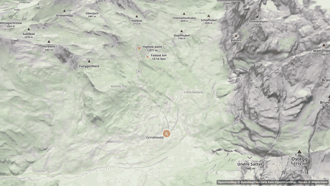
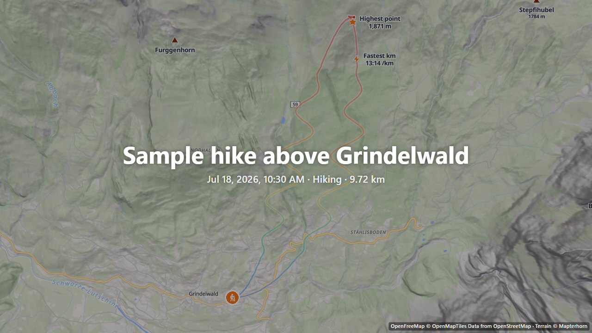
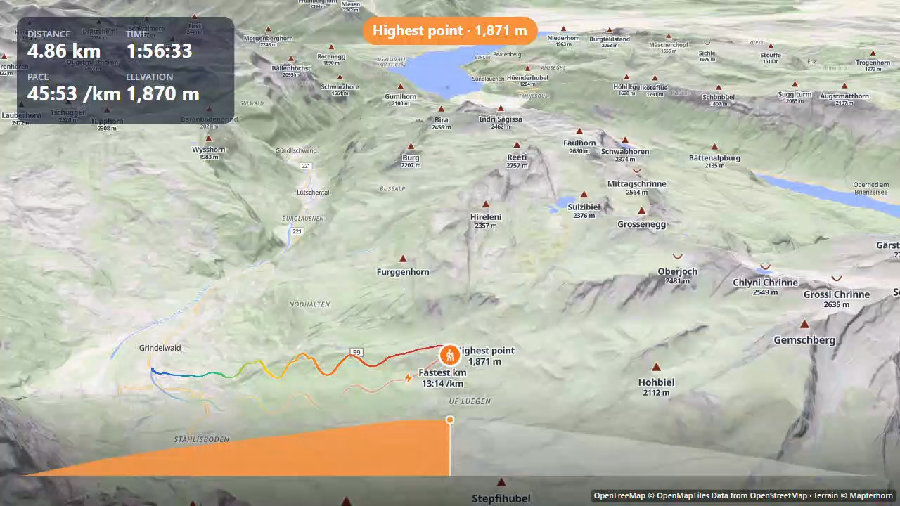
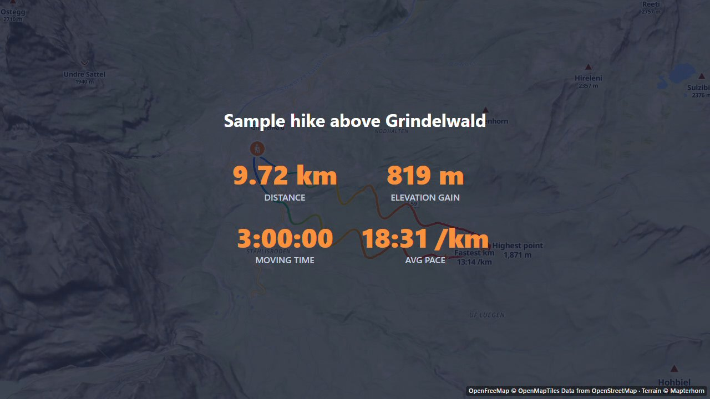

# OpenFlyover

Turn a GPS activity (run, ride, hike, ski) and your photos into a cinematic **3D flyover video**,
entirely in your browser. Free and open source: no account, no watermark, no upload.

**[Try it: khansuhai.github.io/ACTIVITY-MAPPER-](https://khansuhai.github.io/ACTIVITY-MAPPER-/)**
(click "Try a sample" if you have no activity file at hand)



## Features

- **Import** GPX, TCX, FIT (Garmin, COROS, Suunto, Polar…) and KML. Get distance, moving and
  elapsed time, elevation gain, average and max speed, with GPS noise filtered out.
- **3D flyover** over real terrain: a smooth chase camera that doesn't jitter on twisty roads,
  an intro dive and an outro pull-back. The camera tilts so a ridge never hides you.
- **Photos at full resolution**, placed by GPS or by the time they were taken (with a
  camera-clock fix). iPhone HEIC works in every browser. Portrait photos are shown whole on a
  blurred backdrop.
- **Overlays**: live stats, an animated elevation profile, title and end cards, highlights
  (highest point, fastest km), summit and pass names.
- **Style**: colour themes, route coloured by speed, heart rate or elevation, activity icons
  (or your own picture), outdoor, satellite, minimal and dark maps.
- **Privacy zone**: hide the start and finish around home. Your totals stay correct.
- **Music**: add your own track; it loops and fades in the video.
- **Export MP4**: 16:9, 9:16 (Reels, Shorts), 1:1; 720p, 1080p or 4K; 30 or 60 fps; 15 s to
  3 min. Rendered frame by frame, so it is smooth on any computer.
- **Camera styles**: Chase, Drone, or Cinematic with sweeping angles around highlights. Add a
  title and your own notes along the route; choose how long each photo shows.
- **Android app**: record your run, ride or hike with the screen off (pause, auto-pause, live
  stats), take photos on the way, save the trip, make the video on the phone and share it.
- **Private by design**: files and photos are processed in your browser and never uploaded.

| Title card                                         | Flyover                                 | End card                                       |
| -------------------------------------------------- | --------------------------------------- | ---------------------------------------------- |
|  |  |  |

## Browser support

The app runs in any current browser with WebGL2. **Video export** needs WebCodecs: current
Chrome or Edge (desktop or Android), Safari 26+, or Firefox 130+ on desktop.

Browsers pause rendering in background tabs, so keep the tab visible while exporting. In Chrome
and Edge, "Save straight to a file" streams long and 4K videos to disk; other browsers build the
video in memory.

## Data sources and attribution

| What                   | Source                                                                                                          | Licence / terms                                         |
| ---------------------- | --------------------------------------------------------------------------------------------------------------- | ------------------------------------------------------- |
| Outdoor, minimal, dark | [OpenFreeMap](https://openfreemap.org) © [OpenMapTiles](https://openmaptiles.org)                               | Free, no key; attribution required                      |
| Map data, peak names   | © [OpenStreetMap](https://www.openstreetmap.org/copyright) contributors                                         | ODbL                                                    |
| Satellite              | [Sentinel-2 cloudless 2016](https://s2maps.eu) by EOX IT Services GmbH (modified Copernicus Sentinel data 2016) | CC BY 4.0 (later editions are non-commercial, not used) |
| Terrain                | [Mapterhorn](https://mapterhorn.com/attribution) (Copernicus GLO-30 and national elevation models)              | Open data; attribution required                         |

Attribution is shown on the map and burned into every exported video. Third-party code licences
are in [THIRD-PARTY-NOTICES.md](THIRD-PARTY-NOTICES.md).

## Develop

Requires Node 24 and pnpm.

```sh
pnpm install
pnpm dev            # http://localhost:5173
pnpm test           # unit tests (Vitest)
pnpm lint && pnpm typecheck && pnpm build
```

Optional helpers (need [uv](https://docs.astral.sh/uv/)):

```sh
pnpm sample:photos  # 24 test photos along the sample hike, in tmp/
pnpm demo:capture   # record the README demo video with headless Chrome (needs pnpm dev)
pnpm demo:media     # turn it into the GIF, stills and social preview image
```

### Android app

Needs the [Android SDK](https://developer.android.com/studio) (Android Studio, or the
command-line tools) and JDK 21.

```sh
pnpm android:sync   # build the web app and copy it into android/
pnpm android:apk    # debug APK in android/app/build/outputs/apk/debug/
```

Or open `android/` in Android Studio and press Run with your phone connected.

How it works, and why: [docs/DECISIONS.md](docs/DECISIONS.md). Contributions are welcome, see
[CONTRIBUTING.md](CONTRIBUTING.md).

## License

[MIT](LICENSE)
